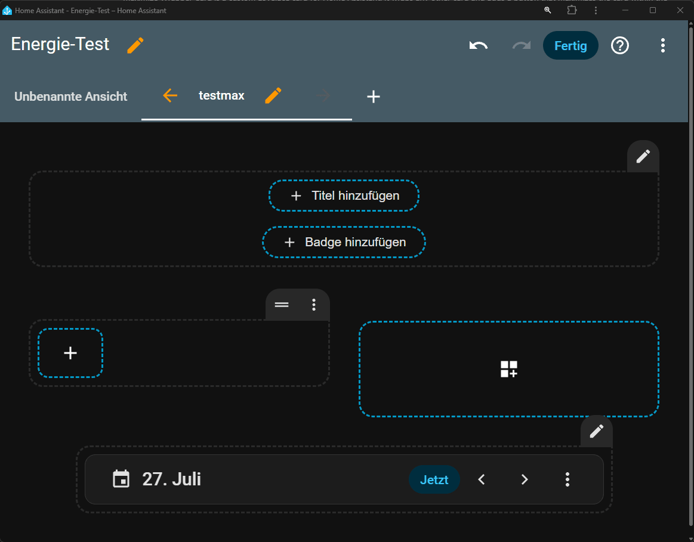

# Maximize Wrapper Card

Maximize Wrapper Card is a custom Lovelace card for Home Assistant. It wraps
any other card and adds a button that maximizes the card within the Home
Assistant interface and restores it to its original size.



The wrapper card:

- works with any Lovelace card,
- accounts for the Home Assistant header, sidebar, and view footer,
- locks background scrolling while the card is maximized,
- supports separate `grid_options` for normal and maximized views,
- includes a visual editor for the embedded card.

## Installation with HACS

1. Add this repository to HACS as a custom repository in the **Dashboard**
   category.
2. Download **Maximize Wrapper Card**.
3. Reload Home Assistant. HACS registers `max-wrapper.min.js` as a Lovelace
   resource.

[](https://my.home-assistant.io/redirect/hacs_repository/?owner=LiBe-net&repository=max-wrapper&category=plugin)

## Usage

The card can be selected in the visual dashboard editor. Alternatively, use
the following YAML configuration:

```yaml
type: custom:maximize-wrapper-card
card:
  type: entities
  title: Example
  entities:
    - entity: sensor.example
```

You can optionally specify a different row height for the maximized view:

```yaml
type: custom:maximize-wrapper-card
grid_options:
  rows: 6
grid_options_full:
  rows: 12
card:
  type: statistics-graph
  entities:
    - sensor.example
```

`grid_options` applies to the normal view. When the card is maximized,
`grid_options_full` is merged on top of it. Settings defined by the embedded
card take precedence.

## Manual installation

Copy `max-wrapper.min.js` to `/config/www/` and add it as a JavaScript module
under **Settings → Dashboards → Resources** in Home Assistant:

```text
/local/max-wrapper.min.js
```

## Development and tests

A current version of Node.js is required.

```bash
npm ci
npm test
```

`npm test` generates the minified HACS file, checks both JavaScript files for
syntax errors, and validates the registrations required by Home Assistant.
GitHub additionally runs HACS validation and the same build test.

## More information and support

Visit [www.libe.net/ha-max](https://www.libe.net/ha-max) for more information.

<a href="https://www.buymeacoffee.com/libe.net" rel="nofollow">
  
</a>

## Version

Current version: **1.0.0**

## License

MIT – see [LICENSE](LICENSE).
